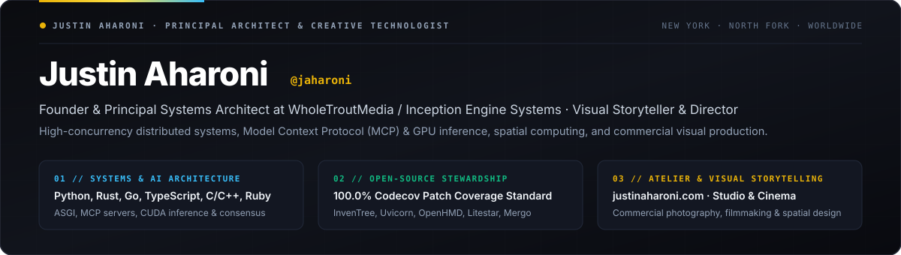

  

### Justin Aharoni (`@jaharoni`)
**Principal Systems & AI Architect · Creative Technologist & Visual Storyteller**  
New York · [justinaharoni.com](https://justinaharoni.com) · [Medium Essays](https://medium.com/@jaharoni) · [Contact](https://justinaharoni.com/contact) · [@WholeTroutMedia](https://github.com/WholeTroutMedia) · [Hugging Face](https://huggingface.co/jaharoni) · [LinkedIn](https://www.linkedin.com/in/justinaharoni)

Architecting high-concurrency distributed systems, applied AI & Model Context Protocol (MCP) infrastructure, spatial computing pipelines, and visual storytelling across Python, Rust, Go, TypeScript/React, C/C++, and Ruby.

---

### Open-Source & Creative Directory

| Channel | Canonical Destination | Scope |
| :--- | :--- | :--- |
| **Personal Website & Studio** | **[justinaharoni.com](https://justinaharoni.com)** | Architecture, commercial photography, filmmaking, essays & fine art |
| **Field Notes & Engineering Essays** | **[medium.com/@jaharoni](https://medium.com/@jaharoni)** | Systems engineering field reports, open-source maintainer studies & essays ([RSS Feed](https://medium.com/feed/@jaharoni)) |
| **Creative Liberation Engine** | **[WholeTroutMedia/creative-liberation-engine](https://github.com/WholeTroutMedia/creative-liberation-engine)** | Open creative foundation + 6 zero-dependency Python stdlib community gifts |
| **Open-Source Engineering Ledger** | **[WholeTroutMedia/open-source-bounties](https://github.com/WholeTroutMedia/open-source-bounties)** | `100.0%` patch-covered upstream PRs, `105+` root-cause case studies & bot-defense shield |
| **Reference Micro-Tools** | **[WholeTroutMedia/open-source-micro-tools](https://github.com/WholeTroutMedia/open-source-micro-tools)** | Zero-dependency Python/CLI & agent-native (`llms.txt` / MCP) reference utilities |
| **Interactive Verification Workbench** | **[wholetroutmedia.github.io/oss-verification-sandbox](https://wholetroutmedia.github.io/oss-verification-sandbox/)** | Client-side browser testbed for UTF-8 stream framing, ASGI lifespans & PR audits |
| **Contact & Collaboration** | **[justinaharoni.com/contact](https://justinaharoni.com/contact)** · **[`contact@jaharoni.com`](mailto:contact@jaharoni.com)** | Open-source collaboration, creative inquiries & community support |
| **Community & Social** | [Medium](https://medium.com/@jaharoni) · [LinkedIn](https://www.linkedin.com/in/justinaharoni) · [Instagram](https://instagram.com/justinaharoni) · [X](https://x.com/justinaharoni) · [Google AI Forum (`@CORTEX`)](https://discuss.ai.google.dev/u/CORTEX) | Essays, visual work & developer community solutions |

---

### Field Notes & Engineering Essays ([`medium.com/@jaharoni`](https://medium.com/@jaharoni))

- **[Supporting Async Context Manager App Factories in Uvicorn Without Breaking ASGI Lifespan](https://medium.com/@jaharoni/supporting-async-context-manager-app-factories-in-uvicorn-without-breaking-asgi-lifespan-23889b42794f)**: How we bridged synchronous
- **[Multi-Node Prefill-Decode Disaggregation in vLLM: Avoiding TCP Fallbacks Across NCCL and RDMA](https://medium.com/@jaharoni/multi-node-prefill-decode-disaggregation-in-vllm-avoiding-tcp-fallbacks-across-nccl-and-rdma-18c732c59097)**: Editorial Translation Note:
- **[871 Unverified Pull Requests in One Week: What Automated PR Spam Is Costing Open-Source Maintainers](https://medium.com/@jaharoni/871-unverified-pull-requests-in-one-week-what-automated-pr-spam-is-costing-open-source-maintainers-3dc35ec95882)**: A field look at 26 automated accounts across 15 operator clusters generating 871 pull requests across public repositories, why standard platform filters are struggling to help, and how builders can keep verification on their own local machines before touching a maintainer’s queue.

---

### Selected Upstream Open-Source Contributions & Systems Research

- **[InvenTree (`#13166`)](https://github.com/inventree/InvenTree/pull/13166)** *(Merged)*: Full-stack hierarchical stock location filtering (`exclude_from_stock`) across Django REST serializers and React/TypeScript (API `v569`) with `100.0%` Codecov patch coverage.
- **[OpenHMD (`#370`)](https://github.com/OpenHMD/OpenHMD/pull/370)** *(Merged)*: Native C XR driver initialization for HTC Vive Pro 2 (`0x0bb4:0x0342` USB ID and 32-byte HID feature report handshake) plus CMake 4.0 policy range compatibility.
- **[Ecosyste.ms Packages (`#1943`)](https://github.com/ecosyste-ms/packages/pull/1943)** *(Merged)*: PyPI `UNKNOWN`/`NONE` license metadata normalization and SPDX classifier fallback with full RSpec verification suite.
- **[Obsidian Raindrop Highlights (`#103`)](https://github.com/kaiiiz/obsidian-raindrop-highlights-plugin/pull/103)** *(Merged)*: Defensive Zod schema evolution for shared collection bookmarks with nullish `creatorRef` payloads.
- **[Coolify (`#9651`)](https://github.com/coollabsio/coolify/pull/9651)** *(Merged)*: Container orchestration environment variable parsing and Pest test verification on `v4.x`.
- **[Uvicorn (`#3250`)](https://github.com/Kludex/uvicorn/pull/3250)** *(100% Coverage)*: ASGI 3.0 lifespan state-machine adapter supporting `@asynccontextmanager` and async generator app factories.
- **[Litestar Advanced Alchemy (`#836`)](https://github.com/litestar-org/advanced-alchemy/pull/836)** *(100% Coverage)*: Unified `KeyError` handling across Sync, Async, Mock (`InMemoryStore`), and Service repositories.
- **[Solana Mainnet Validator Block Ordering (`solana-validator-block-ordering`)](https://github.com/jaharoni/solana-validator-block-ordering)**: Post-Alpenglow empirical measurement suite analyzing intra-block transaction ordering across `Agave` and `Jito` validator clients.
